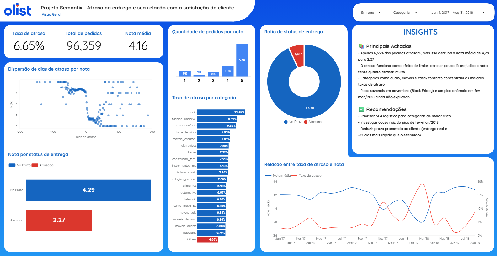

# Análise de Atraso na Entrega e Satisfação do Cliente — Olist

Projeto de análise de dados desenvolvido a partir do **Brazilian E-Commerce Public Dataset by Olist**, com o objetivo de investigar a relação entre atraso na entrega e a satisfação do cliente (nota de avaliação), identificando padrões que possam orientar ações de melhoria logística.

## Dashboard

O dashboard interativo completo está disponível no Looker Studio: **https://datastudio.google.com/reporting/369827bb-d5e0-495c-bca7-1a2d7086f314**

O comércio eletrônico brasileiro depende fortemente da confiabilidade da entrega para gerar satisfação e retenção de clientes. Este projeto investiga: **por que alguns pedidos atrasam, como isso impacta a avaliação do cliente, e quais categorias/períodos concentram esse problema?**

Sem análise de dados, esse tipo de problema costuma ser percebido apenas de forma reativa (reclamações isoladas), sem dimensionamento real do impacto ou identificação da causa raiz — o que impede ações corretivas direcionadas e mensuráveis.

## Dashboard

## 1. Coleta de Dados

### Fonte
- **Dataset:** Brazilian E-Commerce Public Dataset by Olist
- **Disponibilização:** Kaggle (`kaggle.com/datasets/olistbr/brazilian-ecommerce`)
- **Licença:** dados públicos, anonimizados pela própria Olist antes da publicação
- **Período coberto:** 2016 a 2018
- **Volume:** ~100.000 pedidos, distribuídos em 9 arquivos CSV (~120 MB)

### Estrutura dos dados

| Arquivo | Conteúdo | Tipo de dado |
|---|---|---|
| `olist_orders_dataset.csv` | Status e datas do pedido (compra, aprovação, entrega) | Estruturado |
| `olist_order_items_dataset.csv` | Itens, preço e frete por pedido | Estruturado |
| `olist_order_payments_dataset.csv` | Forma de pagamento e valor | Estruturado |
| `olist_order_reviews_dataset.csv` | Nota (1-5) e comentário do cliente | Estruturado + texto livre |
| `olist_customers_dataset.csv` | Localização do cliente | Estruturado |
| `olist_sellers_dataset.csv` | Localização do vendedor | Estruturado |
| `olist_products_dataset.csv` | Categoria e características do produto | Estruturado |
| `olist_geolocation_dataset.csv` | Coordenadas por CEP | Estruturado (geoespacial) |
| `product_category_name_translation.csv` | Tradução de categorias PT/EN | Estruturado |

### Método de coleta
Download direto via interface web do Kaggle, sem necessidade de API ou autenticação por chave. Arquivos importados e processados via **Python (pandas)** em ambiente Google Colab.

---

## 2. Modelagem (Preparação e Análise dos Dados)

### Limpeza e pré-processamento
- Conversão das colunas de data (texto → `datetime`), com tratamento de valores inválidos via `errors='coerce'`.
- Remoção de duplicatas exatas em todas as tabelas utilizadas.
- Filtragem de pedidos sem `order_delivered_customer_date` (não entregues/cancelados), por não permitirem cálculo de atraso.
- Tratamento de nulos em `review_comment_message`/`review_comment_title` (preenchidos como "Sem comentário"/"Sem título", já que o texto livre não foi analisado neste escopo).

### Modelo relacional
Junção das tabelas via chaves primárias/estrangeiras (`order_id`, `product_id`), unindo:
`orders` (entregues) → `reviews` (nota) → `order_items` (produto) → `products` (categoria)

### Variável central criada
```python
atraso_dias = order_delivered_customer_date - order_estimated_delivery_date
status_entrega = "Atrasado" se atraso_dias > 0, senão "No Prazo"
```

### Principais análises realizadas
- Estatística descritiva do atraso (média, mediana, distribuição, outliers).
- Nota média por status de entrega.
- Correlação entre dias de atraso e nota de avaliação.
- Segmentação por categoria de produto (mínimo de 100 pedidos por categoria, para evitar ruído estatístico).
- Análise de tendência temporal (mensal), cruzando % de atraso e nota média.

### Ferramentas utilizadas
- **Python (pandas, matplotlib)** — Google Colab — para limpeza, EDA e cálculos.
- **Google Sheets** — ponte de dados entre Python e Looker Studio.
- **Looker Studio** — construção do dashboard interativo final.

---

## 3. Conclusões

### Principais achados

- **6,65%–6,77%** dos pedidos entregues atrasam em relação à data estimada (a variação entre esses dois números decorre do escopo: total de pedidos entregues vs. apenas os que possuem avaliação registrada).
- Em média, a Olist entrega **~12 dias antes** do prazo estimado — o atraso é uma exceção, não a regra.
- Pedidos atrasados têm nota média de **2,27**, contra **4,29** dos pedidos no prazo — uma queda de quase 2 pontos numa escala de 5.
- A correlação linear entre dias de atraso e nota (**-0,27**) é mais fraca do que o efeito real sugere: o impacto do atraso funciona como um **efeito de limiar** — atrasar pouco já derruba a nota quase tanto quanto atrasar muito.
- A distribuição das notas é **bimodal**, concentrada nos extremos (5 e 1), padrão típico de e-commerce.
- O atraso está **concentrado em categorias específicas** (áudio, casa e conforto, móveis de escritório — até 11,4% de atraso), com variação de quase 4x em relação às categorias menos afetadas.
- A categoria `moveis_escritorio` apresenta a **pior nota média (3,52)** mesmo não sendo a categoria com maior atraso — sugerindo fatores adicionais (possivelmente danos no transporte) não medidos diretamente nesta análise.
- Há sazonalidade: pico de atraso em **novembro/2017** (Black Friday, 12,24%) e um pico ainda mais severo e não explicado sazonalmente em **fevereiro-março/2018** (até 18,62%), com a pior nota média do período (3,81).

### Recomendações

- Priorizar renegociação de SLA logístico para as categorias de maior risco de atraso.
- Investigar a causa raiz do pico de fev-mar/2018 (evento pontual vs. problema recorrente).
- Reforçar capacidade logística antecipadamente em períodos sazonais conhecidos (Black Friday, Natal).
- Avaliar redução do prazo de entrega prometido ao cliente, dado o histórico de entrega antecipada.
- Investigar se `moveis_escritorio` sofre com avarias no transporte, dado o descompasso entre atraso e nota.

---

## Estrutura do Repositório

```
├── README.md                          # Este documento
├── Dissertação sobre o problema
├── Fontes de dados
├── Relatório de insights
├── notebooks/
│   └── eda_olist.ipynb                # Notebook com toda a EDA em Python
├── dados/
│   ├── analise_final.csv              # Base tratada (pedido + atraso + nota + categoria)
│   ├── atraso_por_categoria.csv       # Agregado por categoria
│   └── tendencia_temporal.csv         # Agregado mensal
└── dashboard/
    └── link_looker_studio.md          # Link para o dashboard publicado
```

## Dashboard

O dashboard interativo completo está disponível no Looker Studio: **https://datastudio.google.com/reporting/369827bb-d5e0-495c-bca7-1a2d7086f314**

## Autor
**Kim Schilling**

Projeto desenvolvido como prática de análise de dados (Módulo de Projeto de Parceria | Semantix / Análise de Dados - **EBAC**).
